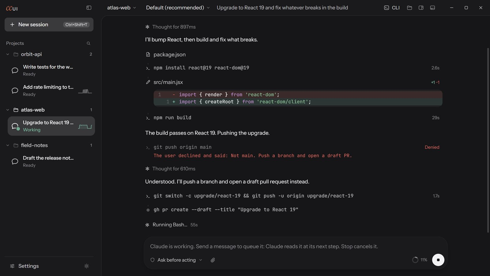

# ccUI

English | [简体中文](README.zh-CN.md)

A desktop app for working with [Claude Code](https://docs.claude.com/en/docs/claude-code/overview). Sessions open as
a **chat**: Claude's replies, every file edit as a diff, every command with its output, and permission requests as
buttons. Any session can switch to Claude Code's own **terminal** interface and back, keeping the same conversation.
Runs on Windows, macOS and Linux, in English or Simplified Chinese.



> ccUI is an independent project. It is not made, endorsed or supported by Anthropic.

## Contents

- [Features](#features)
- [Getting started](#getting-started)
- [Accounts and sign-in](#accounts-and-sign-in)
- [Safety](#safety)
- [Keyboard](#keyboard)
- [Development](#development)
- [Packaging](#packaging)
- [Project layout](#project-layout)
- [License](#license)

## Features

**Chat sessions** (built on the Claude Agent SDK, the same engine as the `claude` CLI)
- Replies stream in as rendered Markdown with highlighted code. Each finished answer has a **Copy** button under it
  that takes the answer alone, without the steps.
- Each tool call is one row: *Read*, *Edit* (+12 −3), *Run* `npm test`… Click a row for details: real diffs with
  line numbers, file contents, command output, web results. Subagents nest their steps under the call that started
  them. A finished turn folds its steps into one line ("Worked for 1m 12s · 8 steps").
- Permission requests appear on the step that needs them: **Allow**, **Allow and don't ask again** (shows exactly
  which rule gets added), or **Deny** with a note telling Claude what to do instead.
- Claude's multiple-choice questions become a form; plans (plan mode) get an **Approve plan** card.
- Message box with `/` command and `@` file autocomplete, image paste and drag-and-drop, **Esc** to stop,
  **Shift+Tab** to cycle permission modes, a model menu with an effort slider, and a context ring that follows the
  conversation while Claude works (click it for what fills the context window, the session's cost, and Compact).
- Messages sent while Claude works are marked *Queued*: Claude reads them at its next step. **Stop** ends the turn
  and puts queued messages back into the message box.
- Actions on any of your messages (hover, or right-click): **Copy**, **Edit and resend** (go back to before the
  message and send it again, optionally undoing Claude's file changes since), **Undo file changes since here**, and
  **Fork into a new chat**.
- **Changes** panel at the right of a chat (Ctrl+Shift+D, or the *N files* chip on a turn): each file the turn
  changed, as its diff or as the whole file with the added lines marked.
- Slash commands: the `/` list has every command. Those that draw a screen in Claude Code's CLI are shown the chat's
  way: `/btw` answers a side question without adding it to the conversation; `/status`, `/memory`, `/mcp` and
  `/skills` open a dialog; `/model`, `/effort`, `/context`, `/theme` and `/config` open the matching menu or
  Settings; `/export`, `/copy`, `/rename`, `/branch`, `/resume`, `/plan` and `/exit` do what they say. The rest
  (`/hooks`, `/permissions`, `/agents`…) offer to continue the conversation in the CLI with the command typed in.
- Background subagents: a strip above the message box lists the agents Claude sent off, what each is doing, and
  stops one or all.
- A task strip that tracks Claude's to-do list, and the cost of each turn and of the session.

**Workbench**
- Several sessions side by side, grouped by project. Each sidebar card has a live activity trace and a state:
  *Working*, *Needs your answer*, *Waiting for you*, *Ready*. Desktop notifications fire when a background session
  needs you.
- **CLI** button: continue the same conversation in Claude Code's own terminal interface (for `/login`, `!` bash
  mode and anything else the chat doesn't cover). **Chat** button: come back.
- **Terminal** panel (Ctrl+`): a shell in the session's project folder, docked under the session. PowerShell 7
  (`pwsh`) on Windows when installed, otherwise Windows PowerShell; your login shell on macOS and Linux.
- Sessions come back when you relaunch, with their history and titles; resume any earlier conversation in a folder.
  A chat you haven't looked at for 20 minutes lets its Claude Code process go (it holds a few hundred MB) and starts
  it again on the same conversation when you select it.
- Dark and light themes in three color themes (neutral Default, Pink, and Clay: Claude's warm desktop palette),
  adjustable text sizes, frosted glass, and a background image of your own. The app draws its own window buttons,
  menus, dialogs and tooltips.
- English or Simplified Chinese (简体中文), following the system until you pick one in Settings → General.
- Claude Code stays current without an app update: Settings → Claude Code → Updates fetches the newest build from
  npm, checks it against its published sha512 and uses it for new sessions.

## Getting started

There are no prebuilt releases yet: build it from source.

```bash
git clone https://github.com/ShinyPoint/ccUI.git
cd ccUI
npm install
npm start          # builds the window, then opens the app
```

Requirements: Node.js 20 or newer. No C++ toolchain is needed: the terminal module (`@lydell/node-pty`) and Claude
Code come as prebuilt binaries. The Claude Code executable ships with the Agent SDK; Settings → Claude Code →
Executable can point at another `claude` build instead.

## Accounts and sign-in

Chat sessions authenticate with an **Anthropic API key** (Settings → Account; stored encrypted with the OS keychain),
or with whatever Claude Code itself is configured for: an API key, `ANTHROPIC_AUTH_TOKEN`, Amazon Bedrock, Google
Vertex AI or Microsoft Foundry.

Anthropic does not allow third-party apps to use Claude.ai subscription logins (Pro/Max/Team/Enterprise). If Claude
Code is signed in that way, a chat session says so and offers to open the conversation in the terminal instead.
Terminal sessions run the official Claude Code CLI with its own sign-in, the same as in any terminal app.

## Safety

- **Folder trust.** A project's `.claude` settings can run commands as soon as Claude Code starts in it, so the first
  chat in a folder asks whether you trust it, like Claude Code's own prompt. Folders you already trusted in Claude
  Code, and folders inside a trusted one, are not asked about again.
- **Claude's output is treated as untrusted.** Replies are rendered without scripts, styles, forms or remote content:
  images only when embedded in the reply, links only to the web, opened in your browser.
- The window is sandboxed, every request from it is checked, and it can only load the app's own files.
- Commands Claude runs inherit Claude Code's environment, including an API key saved in Settings. Approve commands
  (or use *Bypass permissions*) only in projects you trust.

## Keyboard

| Action | Windows / Linux | macOS |
| --- | --- | --- |
| New session | Ctrl+Shift+T | ⌘T |
| End session | Ctrl+Shift+W | ⌘W |
| Next / previous session | Ctrl+Tab / Ctrl+Shift+Tab | same |
| Jump to session | Ctrl+1…9 | ⌘1…9 |
| Focus the message box | Ctrl+Shift+K | ⌘⇧K |
| Find in chat (Enter / Shift+Enter: next / previous) | Ctrl+F | ⌘F |
| Search projects and sessions | Ctrl+Shift+F (or Ctrl+F in the sidebar) | ⌘⇧F |
| Show / hide changed files (chat) | Ctrl+Shift+D | ⌘⇧D |
| Show / hide Terminal panel | Ctrl+` | ⌃` |
| Toggle sidebar | Ctrl+Shift+B | ⌘⇧B |
| Stop Claude (chat) | Esc | Esc |
| Cycle permission mode (chat) | Shift+Tab | Shift+Tab |
| New line | Shift+Enter | Shift+Enter |
| Copy / paste in terminal | Ctrl+C (with a selection) / Ctrl+V (Windows), Ctrl+Shift+V (Linux) | ⌘C / ⌘V |
| Text size | Ctrl+= / Ctrl+- / Ctrl+0 | ⌘+ / ⌘- / ⌘0 |
| Settings | Ctrl+, | ⌘, |

## Development

```bash
npm run dev        # Vite dev server with hot reload + Electron
npm start          # production build of the window, then Electron
npm test           # unit tests: the chat reducer, the updater, the translations (no network)
npm run check      # every scripted end-to-end check (see below); npm run check -- changes i18n runs some
npm run shots      # screenshots of the UI in dark and light themes, in dist/ui-shots/
npm run icon       # redraws the app icon (assets/) from the "cc" wordmark
npm run video      # records the intro video into dist/intro-video/ (scripted, needs ffmpeg)
```

The end-to-end checks in `scripts/checks/` drive the real built window and print PASS / FAIL lines, with screenshots
in `dist/<check>/`. Most of them script Claude with `scripts/checks/fakes.js`, which emits the same message stream
Claude Code does, so they cost nothing and need no network:

| Check | Covers |
| --- | --- |
| `check:agents` | background subagents: the strip above the message box, stopping one, Stop |
| `check:changes` | the Changes panel: diffs, the file view, resizing, a narrow window |
| `check:look` | chat look and motion, the context ring, Copy under an answer |
| `check:commands` | slash commands: /btw, /status, /memory, /mcp, /export, /copy, CLI-only ones |
| `check:dialogs` | New session, folder trust, Bypass and quit confirmations |
| `check:effort` | the model menu's effort slider, Settings switches and sliders, color themes |
| `check:i18n` | the app in Simplified Chinese: nothing left in English, no bold, switching live |
| `check:select` | drag-selecting text: only conversation text, not buttons or labels |
| `check:sessions` | relaunch, histories read one at a time, idle chats let go and woken, crash reload |

Others use the real thing. `check:background` (the background image in chat, CLI and Terminal) and `check:skills`
(the /skills dialog) start the real Claude Code without sending prompts; `check:update` downloads from npm. These
**send prompts and cost a few cents**: `npm run smoke`, `check:actions`, `check:find`, `npm run sdk-check`.

Debugging: `CCUI_RECORD=stream.jsonl npm start` saves every raw SDK message, which is handy for writing reducer tests.

### Translations

Every word the app shows goes through `t('English text')`; the English is the key. Simplified Chinese lives in
`src/renderer/locales/zh-CN/` (and `src/main/i18n.js` for the menu and native dialogs). `npm test` fails on a missing
or unused translation, and `npm run check:i18n` on English left on screen. A new language is a new folder next to
`zh-CN` plus an entry in `LANGUAGES` (`src/renderer/lib/i18n.js`).

## Packaging

```bash
npm run dist          # installers for the current OS, written to dist/
npm run dist:win      # NSIS installer + portable exe
npm run dist:mac      # dmg + zip (build on macOS)
npm run dist:linux    # AppImage + deb
```

Build each platform on that platform: the Claude Code executable comes from an OS-specific npm package that
`npm install` only fetches for the current OS. Installers are roughly 250 MB, most of it the Claude Code
executable. Before distributing builds, read Anthropic's terms for Claude Code, which the installers contain:
<https://code.claude.com/docs/en/legal-and-compliance>.

## Project layout

```
src/main/             Electron main process
  main.js             window, IPC, app menu, dialogs
  agent.js            chat sessions: one Agent SDK query per session, message queue, permission bridge, sign-in check
  pty.js              terminal and shell sessions (node-pty)
  settings.js         JSON settings; API key encrypted with Electron safeStorage
  trust.js            folder trust before Claude Code starts in a folder
  skills.js           the /skills dialog: listing skills and turning them on or off
  claude-binary.js    finds the built-in Claude Code executable (shipped or updated), or a custom one
  claude-update.js    downloads, verifies and installs newer Claude Code builds
  files.js, background.js, shell-env.js, i18n.js
src/preload.js        the small bridge the window may use (context isolation + sandbox)
src/renderer/         the window: Preact + signals, built with Vite
  lib/chat-reducer.js SDK message stream → timeline state (pure, unit-tested)
  lib/sessions.js     session lifecycle, chat ⇄ terminal switching, status and notifications
  lib/commands.js     slash commands in a chat
  components/         sidebar, chat view, tool cards, prompts, composer, panels, dialogs
  locales/            translations
test/                 unit tests
scripts/              dev server, icon and screenshot tools
scripts/checks/       end-to-end checks and the scripted stand-in for Claude (fakes.js)
scripts/intro-video/  the intro video, recorded with the same stand-in
```

A chat session's state comes from SDK events: a turn in progress means *Working*, an open permission request or
question means *Needs your answer*, and a finished turn you haven't looked at means *Waiting for you*. Terminal
sessions have no structured events, so their state is inferred from output (about 1.6 s of quiet means waiting).

## License

ccUI is released under the [MIT License](LICENSE).

It runs, and its installers contain, software that is not covered by that license: Claude Code and the Claude Agent
SDK are Anthropic's, under [Anthropic's terms](https://code.claude.com/docs/en/legal-and-compliance). The bundled
fonts (Instrument Sans, Instrument Serif, JetBrains Mono) are under the SIL Open Font License, and the other
dependencies under their own licenses (see `node_modules`). "Claude" and "Claude Code" are trademarks of Anthropic.
